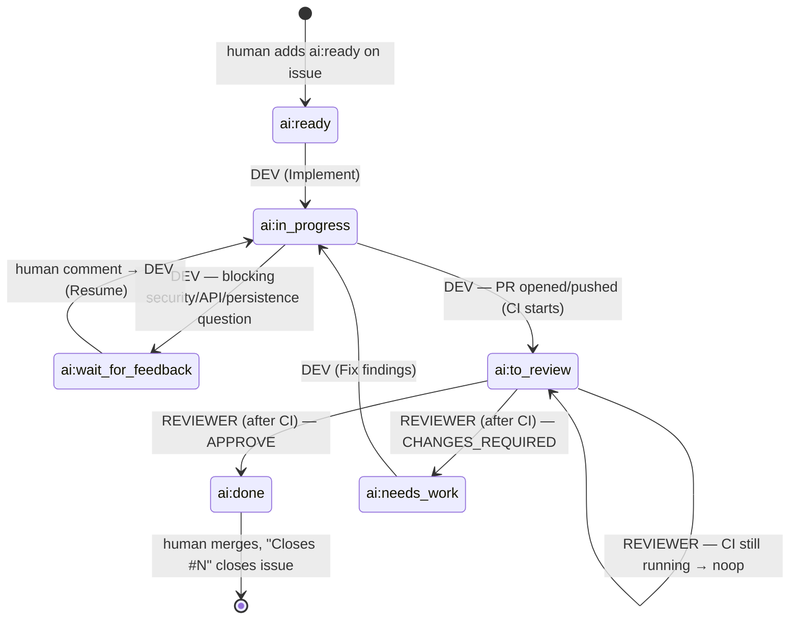

# Presentation plan — AI Developer & Reviewer Agents (label-driven state machine)

**Duration:** 9 min max · **Audience:** dev colleagues · **Sources:**
`.github/workflows/developer-agent.md`, `.github/workflows/reviewer-agent.md` (+ their `.lock.yml`),
`.github/workflows/compile-agentic-workflows.yml`, `.github/workflows/ci.yml`

**Core message (say it in the first 30 s and the last 30 s):**
> Two AI agents, each running under its own GitHub App identity, hand an issue back and forth
> purely by **adding and removing `ai:*` labels**. Labels are the state, label events are the
> transitions, and each agent is only *allowed* to set the labels that belong to its role.

---

## Timeline (9:00)

| # | Slot | Section | Slides |
|---|------|---------|--------|
| 1 | 0:00 – 0:40 | Problem & idea | 1 |
| 2 | 0:40 – 1:40 | How it runs: gh-aw, compile, safe outputs | 1 |
| 3 | 1:40 – 3:00 | The two GitHub Apps — why and how to create them | 2 |
| 4 | 3:00 – 6:30 | **The state machine** (main part) | 3 |
| 5 | 6:30 – 7:30 | Guardrails: CI gate, loops, budget, stale state | 1 |
| 6 | 7:30 – 8:30 | Real example: label timeline of one issue | 1 |
| 7 | 8:30 – 9:00 | Takeaways + where to look | 1 |

About 10 slides. Section 4 gets ~40% of the time on purpose. If you run long, cut section 5
down to a single sentence; never cut section 4.

---

## 1. Problem & idea (0:40)

- Goal: a human writes an issue, adds **one label** (`ai:ready`), and later gets back a PR that has
  already been reviewed.
- Two agents with different jobs (both currently on Gemini via the gh-aw `gemini` engine):
  - **Developer agent**: `gemini-3.8-flash`, up to 60 turns. Classifies the issue as
    TRIVIAL / NORMAL / COMPLEX (each with its own budget of model calls), implements it with tests,
    runs `mvn -B verify`, and opens or updates the PR.
  - **Reviewer agent**: `gemini-2.5-pro`, up to 35 turns. Never changes code and never builds.
    It gates on CI, then posts a `VERDICT: APPROVE | CHANGES_REQUIRED` review plus inline comments.
- No orchestrator, no polling, no scheduler. **GitHub labels (plus the CI completion event) are
  the only coordination mechanism.**

---

## 2. How it runs (1:00)

One slide, one diagram: `*.md` → `gh aw compile` → `*.lock.yml` → GitHub Actions jobs.

- The workflows are written as **GitHub Agentic Workflows (gh-aw)** markdown. The YAML frontmatter
  holds triggers, permissions, engine and safe outputs. The markdown body is the agent's prompt.
- `compile-agentic-workflows.yml` recompiles the `.lock.yml` on every push to the `.md` files and
  commits it as `chore: recompile …`. It uses the `GH_AW_WORKFLOW_PAT` token because `GITHUB_TOKEN`
  can't push workflow files.
- Compiled job pipeline: `pre_activation → activation → agent → safe_outputs → conclusion`.
- **Key security idea, safe outputs:** the agent job has **read-only** permissions
  (`contents/issues/pull-requests/checks/statuses: read`). The agent can only *request* writes such
  as `add_labels`, `create_pull_request` or `submit_pull_request_review`. A separate
  `safe_outputs` job checks each request against an allowlist and runs it with the GitHub App token.
- Side effect worth one sentence: all requested writes are applied **after** the agent finishes.
  So `ai:in_progress` is never visible on GitHub while the agent is working; it's set and replaced
  in the same final step.

---

## 3. The two GitHub Apps (1:20)

### Slide 3a — Why two apps? (3 bullets, ~30 s)

1. **Events created with `GITHUB_TOKEN` don't trigger other workflows.** If the developer added
   `ai:to_review` with the default token, the reviewer would never start. Labels added and commits
   pushed by an **App token do fire events** (`labeled`, and CI on the push), and that is what
   chains the agents together.
2. **Separate identities.** GitHub won't let the author of a PR approve it. The PR is opened by
   `jobshunter-dev-agent-crisnct[bot]` and reviewed by `jobshunter-review-agent-crisnct[bot]`, so
   the reviewer's APPROVE is a real approval.
3. **Mutual allowlisting.** gh-aw ignores bot-triggered events by default. Each workflow names the
   *other* bot in `bots:`, and the reviewer's `if:` also requires the PR author to be the dev bot
   and the title to start with `[AI] `.

### Slide 3b — How to create them (checklist, ~50 s; show it once, don't read every line)

Do this twice: once for the developer app, once for the reviewer app.

1. GitHub → *Settings → Developer settings → GitHub Apps → New GitHub App*.
2. **Name.** It becomes the bot login `<slug>[bot]`, which is referenced in `bots:`, in the
   reviewer `if:` and in both prompts. Rename the app and you must update the workflows too.
3. Homepage URL: anything (the repo URL). **Webhook: uncheck "Active"** because Actions handles
   the events.
4. **Repository permissions.** These match what the lock files request from
   `actions/create-github-app-token`:

   | Permission | Developer app | Reviewer app |
   |---|---|---|
   | Contents | Read & write (push branch) | — |
   | Issues | Read & write (labels, comments) | Read & write (labels on the linked issue) |
   | Pull requests | Read & write (create/update PR) | Read & write (review, inline comments) |
   | Administration | Read | — |
   | Metadata | Read (mandatory) | Read (mandatory) |

5. "Where can this app be installed?" → *Only on this account*.
6. Create the app → **copy the Client ID** → **Generate a private key** (downloads a `.pem`).
7. *Install App* → *Only select repositories* → `jobshunter-mcp-server`.
8. In the repo, go to *Settings → Secrets and variables → Actions*:
   - Variables: `AI_DEVELOPER_APP_CLIENT_ID`, `AI_REVIEWER_APP_CLIENT_ID`
   - Secrets: `AI_DEVELOPER_APP_PRIVATE_KEY`, `AI_REVIEWER_APP_PRIVATE_KEY` (full `.pem`
     contents), `GEMINI_API_KEY`, `GH_AW_WORKFLOW_PAT`
9. At runtime, the `safe_outputs` job mints a short-lived installation token scoped to this one
   repo. No long-lived PAT is used by the agents.

---

## 4. The state machine (3:30) — the main part

### Slide 4a — The diagram (~1:30). Build it up step by step; don't show it all at once.



What to say:

- **Labels are the state. A `labeled` event is the transition.** Developer listens for
  `issues: ai:ready`, `pull_request: ai:needs_work`, and human comments while
  `ai:wait_for_feedback`. Reviewer listens for `pull_request: ai:to_review` **and** for CI
  completing on an `ai/issue-*` branch.
- **Why two reviewer triggers:** the label is applied in the same step that pushes the code, so the
  label event almost always arrives while CI is still queued. The reviewer then does nothing and
  leaves `ai:to_review` in place. When CI finishes, the `workflow_run` event starts the reviewer
  again for the same PR, and this time it really reviews.
- The loop `to_review → needs_work → in_progress → to_review` is the dev↔review cycle. It runs on
  its own until the reviewer approves.
- The only human touchpoints are: add `ai:ready`, answer questions while in `wait_for_feedback`,
  and merge after `ai:done`.

### Slide 4b — Who may set which label (~1:00). This is what makes the machine safe.

These permissions are enforced by the `safe-outputs` allowlist, not by the prompt.

| Label | Added by | Removed by |
|---|---|---|
| `ai:ready` | **human** | developer |
| `ai:in_progress` | developer | developer |
| `ai:wait_for_feedback` | developer | developer |
| `ai:to_review` | developer (also automatically on PR creation via `create-pull-request.labels`) | developer, reviewer |
| `ai:needs_work` | **reviewer** | developer, reviewer |
| `ai:done` | **reviewer** | reviewer |

Point out that the developer **cannot** mark its own work `ai:done` or `ai:needs_work`, and the
reviewer **cannot** restart development. Even if a prompt injection convinced one agent to try, the
safe-outputs job would reject the request.

The reviewer updates labels on **two targets**: the PR, and the issue GitHub reports as linked
through the closing-issue relationship (a GraphQL `closingIssuesReferences` query, never a bare
`#123` mention). On each target it removes any of `to_review` / `needs_work` / `done`, then adds
exactly one.

### Slide 4c — The entry flows (~1:00). One row per trigger.

| Trigger | Flow | Label moves |
|---|---|---|
| `issues` labeled `ai:ready` | **Implement**: duplicate-PR check → branch `ai/issue-<n>-…` → classify → code + tests → `mvn -B verify` → PR `[AI] …` whose body is just a summary + `Closes #n` | `ready → in_progress → to_review`; new PR is born with `to_review` |
| `pull_request` labeled `ai:to_review` | **Reviewer**: check CI for the head commit. Still running → noop. Finished → review | none while pending; otherwise `to_review → done / needs_work` |
| `workflow_run`: CI completed on `ai/issue-*` | **Reviewer**: find the PR for that commit; review only if it still has `to_review` and the commit is still the PR head | `to_review → done / needs_work` |
| `pull_request` labeled `ai:needs_work` | **Developer, fix findings**: read the latest `VERDICT:` review; stop if its `COMMIT:` is stale; fix every `PROBLEMS:` item | `needs_work → in_progress → to_review` (new push → CI → reviewer again) |
| `issue_comment` while `ai:wait_for_feedback` | **Developer, resume**: read the question + the human answer, continue without starting over | `wait_for_feedback → in_progress → to_review` |

The review contract between the two agents is the review body:

```text
VERDICT: APPROVE | CHANGES_REQUIRED
COMMIT: <reviewed head SHA>
PROBLEMS:          ← every item is mandatory for the developer
WELL_IMPLEMENTED:
OPTIONAL:          ← ignored by the developer
```

Subtle point worth 10 seconds: adding a label that's already on the item fires **no** event. That
is why every transition is *remove old + add new*, and why the reviewer removes `ai:to_review` so
the developer can add it back later.

---

## 5. Guardrails (1:00)

- **CI gate:** the reviewer never builds. It only looks at the `Build and test` job of `CI` for the
  current head commit and ignores the agent workflows' own check runs. CI failed → automatic
  `CHANGES_REQUIRED` with a `CI` problem. A PR that only touches files CI ignores (README, LICENSE…)
  is reviewed without CI.
- **No duplicate reviews:** both reviewer triggers share one concurrency group per branch. The run
  that goes second sees the label already swapped and does nothing.
- **No infinite ping-pong:** after **4** consecutive `ai:needs_work` cycles, the developer asks a
  human instead of continuing.
- **Stale reviews:** the developer ignores a verdict whose `COMMIT:` isn't the current head.
- **Who can resume:** comments only count when the item has `ai:wait_for_feedback`, the author is
  not a bot, and the author is OWNER, MEMBER or COLLABORATOR (checked in pre-activation).
- **Budget discipline inside the prompt:** the developer has per-class budgets (10 / 30 / 60 model
  calls, 1 / 2 / 3 discovery rounds, a reserved delivery budget) and an "implement the obvious
  minimal solution" rule. Every run must end as *Completed*, *Draft*, *Human input required*, or
  *No work*.
- **File allowlist:** the developer can only push `src/**`, `pom.xml`, `README.md`,
  `architecture/**`, `Dockerfile`, `docker-compose.yml`. It can never touch `.github/**`.

---

## 6. Real example (1:00)

**Don't run it live.** One run takes several minutes, CI adds more, and an LLM run isn't
deterministic. Instead, prepare one slide with screenshots of a real issue/PR:

1. The issue's **timeline** showing the label events and which bot made each one
   (`ready → in_progress → to_review`).
2. The PR timeline: `to_review` → CI check → reviewer's `CHANGES_REQUIRED` with an inline finding →
   `needs_work` → dev push + comment → CI → `to_review` → `APPROVE` → `ai:done`.
3. Optional: the Actions tab showing a reviewer run that ended in `noop` (CI pending), then a
   second reviewer run started by "CI completed".

Prep: run one small issue through end to end a day before and take the screenshots then.

---

## 7. Takeaways (0:30)

1. Labels are the state machine. Label events (plus CI completion) are the transitions. No
   orchestrator.
2. Two GitHub Apps: one so events chain (the `GITHUB_TOKEN` limitation), one so approvals are real
   (separate identity).
3. Safety comes from configuration (read-only agent + safe-outputs allowlists), not from trusting
   the prompt.

Where to look: `developer-agent.md` §5–6 and §11–12; `reviewer-agent.md` sections "Entry points",
"CI gate", "Label management" and "Output rules".

---

## Before you present

- Push the workflow changes so `compile-agentic-workflows.yml` regenerates both `.lock.yml` files.
  Check that the compile run succeeds: the CI-completion trigger and the `workflow_run` expressions
  in the reviewer prompt have not been compiled yet.
- Run one issue end to end to collect the screenshots for section 6.
