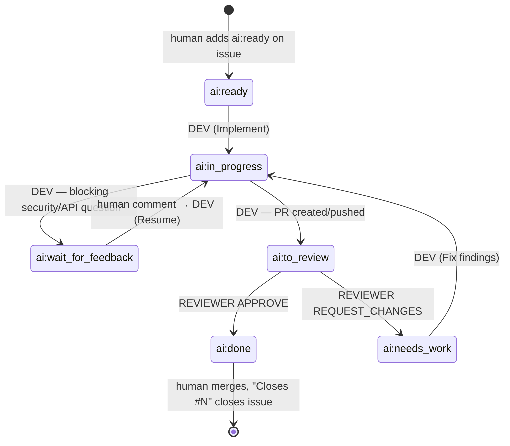

# Presentation plan — AI Developer & Reviewer Agents (label-driven state machine)

**Duration:** 9 min max · **Audience:** dev colleagues · **Sources:**
`.github/workflows/developer-agent.md`, `.github/workflows/reviewer-agent.md` (+ their `.lock.yml`),
`.github/workflows/compile-agentic-workflows.yml`

**Core message (say it in the first 30 s and the last 30 s):**
> Two AI agents, each running under its own GitHub App identity, hand an issue back and forth
> purely by **adding and removing `ai:*` labels**. Labels are the state, label events are the
> transitions, and each agent is only *allowed* to set the labels that belong to its role.

---

## Timeline (9:00)

| # | Slot | Section | Slides |
|---|------|---------|--------|
| 1 | 0:00 – 0:40 | Problem & idea | 1 |
| 2 | 0:40 – 1:40 | How it runs: gh-aw, compile, safe outputs | 1 |
| 3 | 1:40 – 3:00 | The two GitHub Apps — why and how to create them | 2 |
| 4 | 3:00 – 6:30 | **The state machine** (main part) | 3 |
| 5 | 6:30 – 7:30 | Guardrails: loops, budget, stale state | 1 |
| 6 | 7:30 – 8:30 | Real example: label timeline of one issue | 1 |
| 7 | 8:30 – 9:00 | Takeaways + where to look | 1 |

About 10 slides. Section 4 gets ~40% of the time on purpose. If you run long, cut section 5
down to a single sentence; never cut section 4.

---

## 1. Problem & idea (0:40)

- Goal: a human writes an issue, adds **one label** (`ai:ready`), and later gets back a PR that has
  already been reviewed.
- Two agents with different jobs:
  - **Developer agent**: Claude Haiku 4.5, medium effort, 60 turns. Implements the issue, writes
    tests, runs `mvn verify`, opens or updates the PR.
  - **Reviewer agent**: Claude Sonnet 5, high effort, 35 turns. Never changes code. Posts inline
    findings plus an APPROVE / REQUEST_CHANGES verdict.
- No orchestrator, no polling, no scheduler. **GitHub labels are the only coordination mechanism.**

---

## 2. How it runs (1:00)

One slide, one diagram: `*.md` → `gh aw compile` → `*.lock.yml` → GitHub Actions jobs.

- The workflows are written as **GitHub Agentic Workflows (gh-aw)** markdown. The YAML frontmatter
  holds triggers, permissions, engine and safe outputs. The markdown body is the agent's prompt.
- `compile-agentic-workflows.yml` recompiles the `.lock.yml` on every push to the `.md` files and
  commits it as `chore: recompile …`. It uses the `GH_AW_WORKFLOW_PAT` token because `GITHUB_TOKEN`
  can't push workflow files.
- Compiled job pipeline: `pre_activation → activation → agent → safe_outputs → conclusion`.
- **Key security idea, safe outputs:** the agent job has **read-only** permissions
  (`contents/issues/pull-requests: read`). The agent can only *request* writes such as
  `add_labels`, `create_pull_request` or `submit_pull_request_review`. A separate `safe_outputs` job
  checks each request against an allowlist and runs it with the GitHub App token.

---

## 3. The two GitHub Apps (1:20)

### Slide 3a — Why two apps? (3 bullets, ~30 s)

1. **Events created with `GITHUB_TOKEN` don't trigger other workflows.** If the developer added
   `ai:to_review` with the default token, the reviewer would never start. Labels added by an
   **App token do fire `labeled` events**, and that is what chains the agents together.
2. **Separate identities.** GitHub won't let the author of a PR approve it. The PR is opened by
   `jobshunter-dev-agent-crisnct[bot]` and reviewed by `jobshunter-review-agent-crisnct[bot]`, so
   the reviewer's APPROVE is a real approval.
3. **Mutual allowlisting.** gh-aw ignores bot-triggered events by default. Each workflow names the
   *other* bot in `bots:`, and the reviewer's `if:` also requires the PR author to be the dev bot
   and the title to start with `[AI] `.

### Slide 3b — How to create them (checklist, ~50 s; show it once, don't read every line)

Do this twice: once for the developer app, once for the reviewer app.

1. GitHub → *Settings → Developer settings → GitHub Apps → New GitHub App*.
2. **Name.** It becomes the bot login `<slug>[bot]`, which is referenced in `bots:` and in the
   reviewer `if:`. Rename the app and you must update the workflows too.
3. Homepage URL: anything (the repo URL). **Webhook: uncheck "Active"** because Actions handles
   the events.
4. **Repository permissions.** These match what the lock files request from
   `actions/create-github-app-token`:

   | Permission | Developer app | Reviewer app |
   |---|---|---|
   | Contents | Read & write (push branch) | — |
   | Issues | Read & write (labels, comments) | Read & write (labels) |
   | Pull requests | Read & write (create/update PR) | Read & write (review, inline comments) |
   | Administration | Read | — |
   | Metadata | Read (mandatory) | Read (mandatory) |

5. "Where can this app be installed?" → *Only on this account*.
6. Create the app → **copy the Client ID** → **Generate a private key** (downloads a `.pem`).
7. *Install App* → *Only select repositories* → `jobshunter-mcp-server`.
8. In the repo, go to *Settings → Secrets and variables → Actions*:
   - Variables: `AI_DEVELOPER_APP_CLIENT_ID`, `AI_REVIEWER_APP_CLIENT_ID`
   - Secrets: `AI_DEVELOPER_APP_PRIVATE_KEY`, `AI_REVIEWER_APP_PRIVATE_KEY` (full `.pem`
     contents), `ANTHROPIC_API_KEY`, `GH_AW_WORKFLOW_PAT`
9. At runtime, the `safe_outputs` job mints a short-lived installation token scoped to this one
   repo. No long-lived PAT is used by the agents.

---

## 4. The state machine (3:30) — the main part

### Slide 4a — The diagram (~1:30). Build it up step by step; don't show it all at once.

What to say:

- **Labels are the state. A `labeled` event is the transition.** Each workflow listens for exactly
  one label name: developer on `issues: ai:ready` and `pull_request: ai:needs_work`, reviewer on
  `pull_request: ai:to_review`.
- The loop `to_review → needs_work → in_progress → to_review` is the dev↔review cycle. It runs on
  its own until the reviewer approves.
- The only human touchpoints are: add `ai:ready`, answer questions while in `wait_for_feedback`,
  and merge after `ai:done`.

### Slide 4b — Who may set which label (~1:00). This is what makes the machine safe.

These permissions are enforced by the `safe-outputs` allowlist, not by the prompt.

| Label | Added by | Removed by |
|---|---|---|
| `ai:ready` | **human** | developer |
| `ai:in_progress` | developer | developer |
| `ai:wait_for_feedback` | developer | developer |
| `ai:to_review` | developer (also automatically on PR creation via `create-pull-request.labels`) | developer, reviewer |
| `ai:needs_work` | **reviewer** | developer |
| `ai:done` | **reviewer** | — |

Point out that the developer **cannot** mark its own work `ai:done` or `ai:needs_work`, and the
reviewer **cannot** restart development. Even if a prompt injection convinced one agent to try, the
safe-outputs job would reject the request.

### Slide 4c — The three entry flows (~1:00). One row per trigger.

| Trigger | Developer flow | Label moves |
|---|---|---|
| `issues` labeled `ai:ready` | **Implement**: duplicate-PR check → branch `ai/issue-<n>-…` → code + tests → `mvn verify` → PR `[AI] …` with `Closes #n` | issue: `ready → in_progress → to_review`; new PR is born with `to_review` → **reviewer starts** |
| `pull_request` labeled `ai:needs_work` | **Fix findings**: read the latest verdict + `MANDATORY` inline findings only → fix → push → comment | `needs_work → in_progress → to_review` (re-adding `to_review` **re-triggers the reviewer**) |
| `issue_comment` while `ai:wait_for_feedback` | **Resume**: read the question + the human answer, continue without starting over | `wait_for_feedback → in_progress → to_review` (or back to `wait_for_feedback`) |

Reviewer flow, in one line: review the diff against the issue → inline comments (≤10) → **one**
review → **add** `ai:done`/`ai:needs_work` **and remove** `ai:to_review` on the PR **and** its linked issue (found via `Closes #n`). Stress the two separate
calls: if the label swap doesn't happen, the chain stalls, because nothing listens for "review
posted".

Subtle point worth 10 seconds: adding a label that's already on the item fires **no** event. That
is why every transition is *remove old + add new*, and why the reviewer must remove `ai:to_review`
so the developer can add it back later to trigger the next review.

---

## 5. Guardrails (1:00)

- **No infinite ping-pong:** after **4** consecutive `ai:needs_work` cycles, the developer asks a
  human instead of continuing.
- **Stale reviews:** if the verdict refers to an old head SHA, the developer emits `noop` and leaves
  the label unchanged.
- **Who can resume:** comments only count when the item has `ai:wait_for_feedback`, the author is
  not a bot, and the author is OWNER, MEMBER or COLLABORATOR (checked in pre-activation).
- **Concurrency:** one run per item + label/comment (`cancel-in-progress: false`), so events are
  queued, not dropped.
- **Budget discipline inside the prompt:** the developer has phases A–D with a "practical deadline"
  at call 28, a scope lock, a ban on inspecting dependency internals or debugging the runner, and an
  "implement the obvious minimal solution" rule. Every run must end in one of three outcomes:
  *Implemented*, *Human decision required*, or *No work needed*.
- **File allowlist:** the developer can only push `src/**`, `pom.xml`, `README.md`,
  `architecture/**`, `Dockerfile`, `docker-compose.yml`. It can never touch `.github/**`.

---

## 6. Real example (1:00)

**Don't run it live.** One run takes several minutes and an LLM run isn't deterministic. Instead,
prepare one slide with screenshots of a real issue/PR:

1. The issue's **timeline** showing the label events and which bot made each one
   (`ready → in_progress → to_review`).
2. The PR timeline: `to_review` → reviewer's REQUEST_CHANGES with an inline finding →
   `needs_work` → dev push + comment → `to_review` → APPROVE → `ai:done`.
3. Optional: the Actions tab with the alternating "AI Developer Agent" / "AI Reviewer Agent" runs.

Prep: run one small issue through end to end a day before and take the screenshots then.

---

## 7. Takeaways (0:30)

1. Labels are the state machine. Label events are the transitions. No orchestrator.
2. Two GitHub Apps: one so events chain (the `GITHUB_TOKEN` limitation), one so approvals are real
   (separate identity).
3. Safety comes from configuration (read-only agent + safe-outputs allowlists), not from trusting
   the prompt.

Where to look: `.github/workflows/developer-agent.md` §11–14, `reviewer-agent.md` §3, §7, §9–10.

---

## Before you present

`reviewer-agent.md` was restored (route, linked-issue label swap, process with the stale-SHA check,
review criteria, `MANDATORY`/`OPTIONAL` classification, verdict format). Commit and push it so
`compile-agentic-workflows.yml` regenerates `reviewer-agent.lock.yml` before the demo run.
